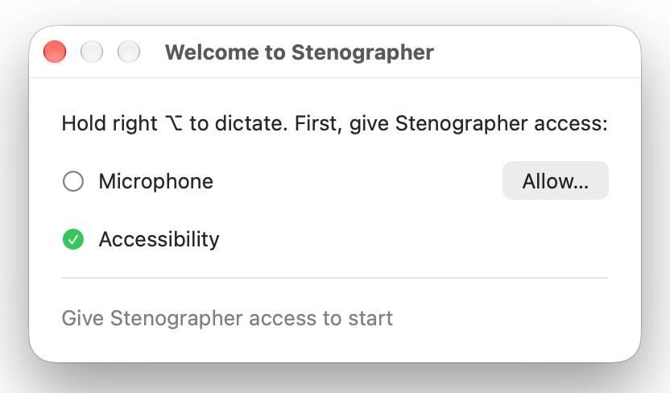

<p align="center">
  
</p>

# Stenographer

Dictation for the macOS menu bar. Hold the **right Option** key, speak, and release. The text is
pasted into the app you are using.

- Speech recognition runs on your Mac with Parakeet TDT 0.6B v3 (25 European languages, see
  below). The app downloads the model (about 480 MB) the first time it starts. Your speech does
  not go to the internet.
- While you hold right Option, a small glass bubble shows at the bottom of the screen with a
  waveform and a red dot. When you release, a spinner shows until the text is pasted.
- Stenographer removes filler sounds such as "um", "uh", "erm" and "hmm". It does not remove
  words that are real words in one of the languages, for example "er" and "eh".
- Stenographer writes years, times and large numbers with digits: "twenty fifteen" becomes 2015,
  "half one" becomes 1:30 and "three pm" becomes 3pm. Numbers from zero to nine stay words, as in
  "one question". This works only in English.
- On a Mac with Apple Intelligence on, Apple's on-device model corrects words that the speech model
  heard wrong: "Twitch the 9am meeting" becomes "Switch the 9am meeting". It also reads the text
  before the cursor in the app, and uses it to spell names and terms ("Jeff" becomes "Geoff" when
  "Geoff" is on the screen). It does not read password fields. The text and your speech stay on
  your Mac. This works in Danish, Dutch, English, French, German, Italian, Portuguese, Spanish and
  Swedish. If the result changes more than a few words, or takes more than 2 seconds,
  Stenographer pastes the text without the correction.
- When the text ends with a full stop or other punctuation, Stenographer adds a space after it. Then
  the next dictation does not join on to it.
- A short tap of right Option does nothing. If you press another key while you hold right Option
  (for example ⌥3 for #), the recording stops and nothing is pasted.
- Paste also works in Chrome and in Electron apps such as Slack and VS Code, and with all
  keyboard layouts, also Dvorak.
- Your clipboard is put back after the paste. If no app takes the text, it stays on the clipboard so
  that you can paste it yourself.

## Languages

Stenographer finds the language by itself. You do not choose it. It supports these 25 languages:

Bulgarian, Croatian, Czech, Danish, Dutch, English, Estonian, Finnish, French, German, Greek,
Hungarian, Italian, Latvian, Lithuanian, Maltese, Polish, Portuguese, Romanian, Russian, Slovak,
Slovenian, Spanish, Swedish and Ukrainian.

This is the list of the speech model,
[Parakeet TDT 0.6B v3](https://huggingface.co/nvidia/parakeet-tdt-0.6b-v3).

## Install

Needs macOS 26 or later.

With [Homebrew](https://brew.sh):

```sh
brew install --cask knorthfield/tap/stenographer
```

To uninstall, first click the waveform icon in the menu bar and click **Quit Stenographer**. Then:

```sh
brew uninstall --cask stenographer
```

To also remove the settings of Stenographer, add `--zap`:
`brew uninstall --zap --cask stenographer`. The speech model stays in
`~/Library/Application Support/FluidAudio/Models/parakeet-tdt-0.6b-v3`, because other apps that
use FluidAudio can use the same model. If no other app uses it, you can delete this folder to get
back about 480 MB.

Or download `Stenographer.zip` from the
[latest release](https://github.com/knorthfield/stenographer/releases/latest), unzip it, and move
`Stenographer.app` to Applications.

Then:

1. Open Stenographer. A waveform icon shows in the menu bar, and the **Welcome to Stenographer**
   window opens.
2. In the window, click **Allow…** for the microphone and for Accessibility. For Accessibility,
   turn on Stenographer in System Settings › Privacy & Security › Accessibility. A green tick
   shows for each permission that you give. The window closes when both are on.

   

3. Wait until the menu says **Hold right ⌥ to dictate**. Until then it says **Getting the speech
   model ready…** with a percentage. The first time, the model must download, and this can take
   some minutes. After that, it is quicker.
4. Click in a text field, hold right Option, speak, and release.

Stenographer opens at login. To stop this, click the waveform icon and turn off **Open at Login**.

If you remove a permission later, the window opens again. The menu has the same **Allow…**
buttons.

### Start again as a new install

To see the **Welcome to Stenographer** window again, for example to test it, remove the app, its
settings and its permissions. An uninstall alone keeps the permissions.

```sh
osascript -e 'quit app "Stenographer"'
tccutil reset Microphone com.krisnorthfield.Stenographer
tccutil reset Accessibility com.krisnorthfield.Stenographer
defaults delete com.krisnorthfield.Stenographer
brew uninstall --zap --cask stenographer
brew install --cask knorthfield/tap/stenographer
open -a Stenographer
```

- If `defaults delete` says that the domain does not exist, there were no settings. Continue.
- If Stenographer is still in System Settings › Privacy & Security › Accessibility, select it and
  click **−**.
- To also see the model download again, delete
  `~/Library/Application Support/FluidAudio/Models/parakeet-tdt-0.6b-v3` before you open the app.
  Do not do this if another app that uses FluidAudio needs the model.

## Build

```sh
brew install xcodegen
xcodegen generate
open Stenographer.xcodeproj
```

Put your team in `Local.xcconfig` (not committed): `DEVELOPMENT_TEAM = XXXXXXXXXX`.

To run the tests:

```sh
xcodebuild test -scheme Stenographer
```

## License

MIT. See `LICENSE`. Code adapted from OpenSuperWhisper is listed in `THIRD_PARTY_NOTICES.md`.
